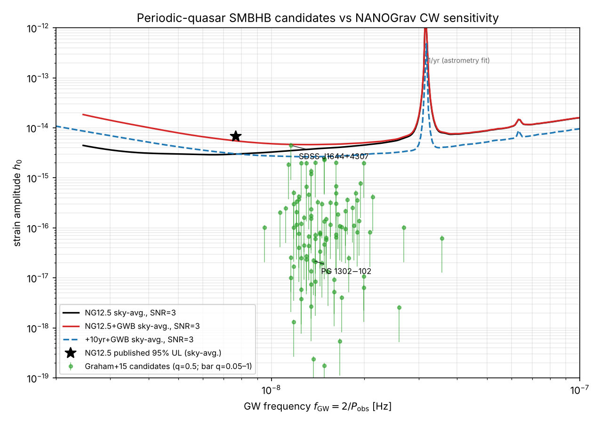

# smbhb-pta-reach

**Which periodic-quasar supermassive black hole binary (SMBHB) candidates can pulsar timing arrays detect?**

This repository computes the continuous-wave (CW) gravitational-wave strain expected from optically
selected SMBHB candidates and compares it with the CW sensitivity of the NANOGrav 12.5-year data set,
evaluated at each candidate's sky position.



## Key results

- 98 of the 111 CRTS periodic-quasar candidates of Graham et al. (2015) have black-hole masses and are analysed.
- **SDSS J164452.71+430752.2** (log M = 10.15, z = 1.72), the most massive candidate, lies at the edge of
  current sensitivity: for an equal-mass binary its strain is ~1.1 times the calibrated NANOGrav 12.5-yr
  sky-averaged 95% upper limit.
- With ~10 more years of timing, three candidates reach SNR >= 3 if they are equal-mass binaries.
- Most candidates, including PG 1302-102, lie one to several orders of magnitude below current sensitivity.

These are forecasts under the assumptions below, not detections or exclusions.

## Method

For each candidate:

- GW frequency: f_GW = 2 / P_obs (optical period taken as the observed orbital period)
- Chirp mass: M_c = M q^(3/5) / (1+q)^(6/5), with the virial black-hole mass taken as the total mass;
  q = 0.5 fiducial, q = 0.05-1 shown as error bars
- Strain: circular-binary amplitude h0 from `hasasia`, using the redshifted chirp mass and luminosity
  distance (Planck18 cosmology)

PTA sensitivity is built with [hasasia](https://github.com/Hazboun6/hasasia) (Hazboun, Romano & Smith 2019)
from the public NANOGrav 12.5-yr TOAs and single-pulsar noise models, for three cases:

1. NANOGrav 12.5-yr, intrinsic pulsar noise only
2. As (1), plus the measured common red process (A = 1.92e-15) treated as noise
3. As (2), projected forward by 10 years (each pulsar's last 3 years of epochs repeated)

**Calibration.** The approximate sensitivity is calibrated against the published NANOGrav 12.5-yr CW
search (Arzoumanian et al. 2023), which placed a sky-averaged 95% upper limit of h0 < 6.82e-15 at 7.65 nHz.
The column `h0_over_h95eq` in `results/candidate_snr.csv` expresses each candidate's strain in units of that limit.

## Usage

```bash
pip install -r requirements.txt
git clone https://github.com/nanograv/12p5yr_stochastic_analysis.git
python run_pta_reach.py --data 12p5yr_stochastic_analysis/tutorials/data
```

Outputs go to `results/`: per-candidate strains and SNRs (`candidate_snr.csv`), a summary (`summary.json`)
and the figure. Options: `--cands` for another candidate catalog (same CSV columns) and `--future` for the
number of projected extra years.

## Caveats

- **Masses:** virial black-hole masses carry ~0.3-0.5 dex uncertainty, a factor ~3-7 in strain (h0 scales as M^(5/3)).
- **Period interpretation:** if the optical period is several times the orbital period (e.g. lopsided-cavity
  models), f_GW is higher than assumed.
- **Sensitivity approximations:** epoch-averaged TOAs with ECORR in quadrature and a simplified timing model
  (quadratic spin-down, astrometry, backend offsets; no DMX). The calibration absorbs most of the resulting
  offset at the reference frequency.
- The sharp feature at 1/yr is the loss of sensitivity from fitting pulsar positions.

## Data and references

- Candidates: Graham, M. J., et al. 2015, MNRAS, 453, 1562 (Table 2)
- PTA data: NANOGrav 12.5-yr data set ([nanograv/12p5yr_stochastic_analysis](https://github.com/nanograv/12p5yr_stochastic_analysis))
- Sensitivity: Hazboun, J. S., Romano, J. D., & Smith, T. L. 2019, PRD, 100, 104028
- CW limits: Arzoumanian, Z., et al. 2023, ApJL, 951, L28
- Related: Xin, C., Mingarelli, C. M. F., & Hazboun, J. S. 2021, ApJ, 915, 97

## Author

Hemanth Bommireddy (Universidad de Chile)
